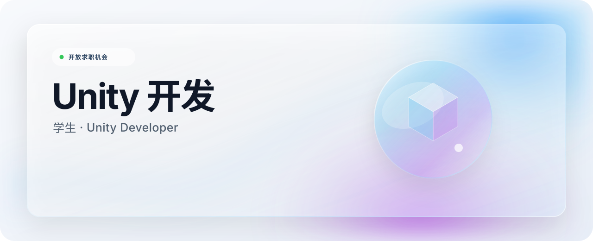

<!--
THESIS: 一张会折射环境色的数字玻璃名片；拒绝统计卡片与技能徽章堆叠。
OWN-WORLD: 冰白与墨黑双主题、蓝紫折射光、整片液态玻璃与精密细线。
STORY: 访客先识别学生 Unity 开发者身份，再通过邮箱发起联系。
FIRST VIEWPORT: 全宽玻璃画布；左侧职业标题，右侧抽象 3D 玻璃体，联系入口紧随其后。
FORM: 求职型个人资料页，采用用户指定的液态玻璃方向；seed 8d21172b。
FINISH: unreviewed and undocumented is unfinished; this build ends with the finish review, the verdict, and DESIGN.md
-->

  <a href="./README_EN.md">English</a>

<!-- Local identity verification comment -->

  

  一名学生 Unity 开发者。

  <a href="mailto:2176253267@qq.com">邮件联系</a>
  &nbsp;&nbsp;·&nbsp;&nbsp;
  个人网站 · 即将上线
  &nbsp;&nbsp;·&nbsp;&nbsp;
  哔哩哔哩 · 即将上线

